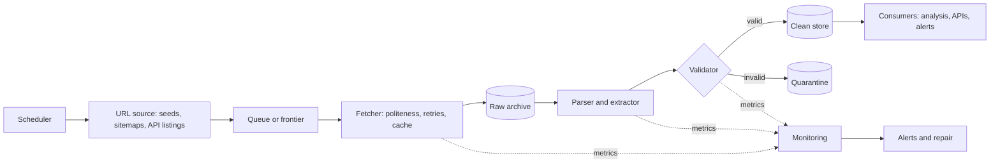

# Anatomy of a Scraper

> Sources: Scrapy documentation, Architecture overview (https://docs.scrapy.org/en/latest/topics/architecture.html); Crawlee documentation (https://crawlee.dev/); Pydantic documentation (https://docs.pydantic.dev/); IIPC, The WARC Format 1.1 (https://iipc.github.io/warc-specifications/specifications/warc-format/warc-1.1/); Martin Kleppmann, Designing Data-Intensive Applications, O'Reilly (https://dataintensive.net/); Google, Site Reliability Engineering, chapter 6 "Monitoring Distributed Systems" (https://sre.google/sre-book/monitoring-distributed-systems/)
> Raw: none yet (seed article)
> Updated: 2026-10-24

## Overview

A production scraper is a pipeline of seven stages: fetch, parse, extract, validate, store, schedule and monitor. Keep the stages separate, with an explicit contract between each pair: the fetcher produces raw responses and archives them, the parser and extractor turn them into candidate records, the validator enforces a schema and invariants, the store writes idempotently with provenance, the scheduler decides when and how fast, and monitoring judges outcomes rather than exit codes. This separation is what makes a scraper cheap to repair: you can re-parse archived responses after a fix without touching the site, test parsers against saved fixtures, and see which stage broke.

## Reference architecture



Scrapy implements most of this inside one process (engine, scheduler, downloader with middlewares, spiders, item pipelines), and Crawlee does the same in Node. A home-grown scraper should still keep the same seams, even when each stage is one function.

## The stages

| Stage | Responsibility | Output | Typical failures | Read next |
|---|---|---|---|---|
| Fetch | HTTP or browser retrieval, politeness, retries, conditional requests, raw archiving | Response bytes plus metadata | Timeouts, 429/403, TLS errors, blocks | [HTTP Fundamentals](../http/http-fundamentals.md) |
| Parse | Bytes to a document: HTML tree, JSON, PDF text | DOM or object | Wrong charset, malformed markup | [HTML and the DOM](../parsing/html-and-the-dom.md) |
| Extract | Pick fields, normalize units, dates and numbers | Candidate records | Selector drift, missing fields | [Writing Robust Selectors](../parsing/robust-selectors.md) |
| Validate | Schema, required fields, ranges, cross-field rules | Valid records and a quarantine | Silent nulls, wrong types | [Schema Validation](../data-quality/schema-validation.md) |
| Store | Idempotent upserts, provenance, raw and clean layers | Tables and files | Duplicates, lost history | [Data Modeling for Scraped Data](../storage/data-modeling-for-scraped-data.md) |
| Schedule | When to run, how fast, no overlapping runs | Runs | Overlaps, thundering herds | [Scheduling and Cron](../operations/scheduling-and-cron.md) |
| Monitor | Counts against baselines, error rates, freshness | Alerts | "Successful" empty runs | [Data Quality Monitoring](../data-quality/data-quality-monitoring.md) |

Discovery (where URLs come from) sits in front of the fetcher; for large or open-ended sites it becomes its own subsystem ([Crawler Architecture](../crawling/crawler-architecture.md)).

## Design principles

- **Raw first.** Archive what you fetched before parsing it. When a parser bug is found, re-run extraction over the archive instead of re-crawling ([Object Storage and Raw Archives](../storage/object-storage-and-raw-archives.md)).
- **Idempotent writes.** Running the same job twice leaves the same state: deterministic keys and upserts, not blind inserts ([Retries, Backoff and Idempotency](../operations/retries-backoff-idempotency.md)).
- **Provenance on every record**: source URL, fetch time, raw reference, parser version ([Provenance and Lineage](../data-quality/provenance-and-lineage.md)).
- **Fail loudly at the run level, gracefully at the record level.** One malformed record goes to quarantine; zero valid records fails the run.
- **Politeness lives in one place.** The fetcher owns rate limits, robots.txt, retries and identification, so no extractor can bypass them.
- **Configuration over code.** URLs, selectors, rates and schedules belong in a spec that agents and humans can review ([Declarative Scraper Specs in This Harness](../harness/harness-scraper-spec.md)).
- **Testable seams.** Parsers are pure functions over saved fixtures ([Testing Scrapers](../data-quality/testing-scrapers.md)).

## A compact skeleton

Each stage is a function; the run returns metrics and exits non-zero when the output is empty or mostly invalid:

```python
import gzip
import hashlib
import json
import pathlib
import sqlite3
import sys
import time
from datetime import datetime, timezone
from urllib.parse import urljoin

import httpx
from pydantic import BaseModel, Field, ValidationError
from selectolax.lexbor import LexborHTMLParser

PARSER_VERSION = "quotes-v3"
RAW_DIR = pathlib.Path("raw")


class Quote(BaseModel):
    text: str = Field(min_length=1)
    author: str = Field(min_length=1)
    tags: list[str] = []
    source_url: str
    fetched_at: datetime
    raw_ref: str


def fetch(client: httpx.Client, url: str) -> httpx.Response:
    r = client.get(url)
    r.raise_for_status()
    return r


def archive(r: httpx.Response) -> str:
    """Keep the exact bytes we parse, so a parser fix can re-run without refetching."""
    RAW_DIR.mkdir(exist_ok=True)
    stamp = datetime.now(timezone.utc).strftime("%Y%m%dT%H%M%S%f")
    path = RAW_DIR / f"{hashlib.sha256(str(r.url).encode()).hexdigest()[:16]}-{stamp}.html.gz"
    path.write_bytes(gzip.compress(r.content))
    return str(path)


def text_of(node, selector: str) -> str:
    found = node.css_first(selector)
    return found.text(strip=True) if found else ""  # a missing field fails validation later


def parse(r: httpx.Response, raw_ref: str) -> tuple[list[dict], str | None]:
    doc = LexborHTMLParser(r.text)
    now = datetime.now(timezone.utc)
    rows = [
        {
            "text": text_of(q, "span.text"),
            "author": text_of(q, "small.author"),
            "tags": [a.text(strip=True) for a in q.css("a.tag")],
            "source_url": str(r.url),
            "fetched_at": now,
            "raw_ref": raw_ref,
        }
        for q in doc.css("div.quote")
    ]
    nxt = doc.css_first("li.next a")
    return rows, (urljoin(str(r.url), nxt.attributes["href"]) if nxt else None)


def store(db: sqlite3.Connection, q: Quote) -> None:
    key = hashlib.sha256(f"{q.author}|{q.text}".encode()).hexdigest()  # natural key, stable across runs
    db.execute(
        "INSERT INTO quotes VALUES (?, ?, ?, ?, ?, ?, ?, ?) ON CONFLICT(key) DO UPDATE SET "
        "tags = excluded.tags, fetched_at = excluded.fetched_at, raw_ref = excluded.raw_ref, parser = excluded.parser",
        (key, q.author, q.text, json.dumps(q.tags), q.source_url, q.fetched_at.isoformat(), q.raw_ref, PARSER_VERSION),
    )


def run(start: str) -> dict:
    db = sqlite3.connect("quotes.db")
    db.execute("CREATE TABLE IF NOT EXISTS quotes (key TEXT PRIMARY KEY, author TEXT, text TEXT, "
               "tags TEXT, source_url TEXT, fetched_at TEXT, raw_ref TEXT, parser TEXT)")
    stats = {"pages": 0, "valid": 0, "invalid": 0, "started": time.time()}
    ua = "quotes-pipeline/1.0 (+https://acme.example/bot; ops@acme.example)"
    with httpx.Client(headers={"User-Agent": ua}, timeout=15.0, follow_redirects=True) as client:
        url = start
        while url and stats["pages"] < 100:
            r = fetch(client, url)
            rows, url = parse(r, archive(r))
            stats["pages"] += 1
            for row in rows:
                try:
                    store(db, Quote(**row))
                    stats["valid"] += 1
                except ValidationError:
                    stats["invalid"] += 1  # count, sample and alert; never crash on one bad record
            db.commit()
            time.sleep(1.0)
    stats["seconds"] = round(time.time() - stats.pop("started"), 1)
    return stats


if __name__ == "__main__":
    stats = run("https://quotes.toscrape.com/page/1/")
    print(json.dumps(stats))
    if stats["valid"] == 0 or stats["invalid"] > 0.05 * max(1, stats["valid"]):
        sys.exit(1)  # an empty or mostly invalid run is a failure, not a success with zero rows
```

Running it twice leaves the same rows (the key is derived from the content, and the write is an upsert). Pointed at a page without quotes, it reports `valid: 0` and exits with status 1, which is what a scheduler needs to raise an alert. A real deployment adds the retry policy from [HTTP Status Codes and How to React](../http/http-status-codes.md), a robots.txt check, and a proper store ([SQLite and DuckDB](../storage/sqlite-and-duckdb.md)).

## Metrics every run should emit

| Metric | Why | Alert when |
|---|---|---|
| Pages fetched, by status code | Access health | 403 or 429 share rises; 5xx persists |
| Valid and invalid records | Extraction health | Zero valid; invalid above a few percent |
| New, changed, unchanged records | Change rates | Sudden zero changes on a lively source |
| Records compared with a rolling baseline | Silent breakage | Volume drops by half against the 7-day median |
| Duration, bytes, retries | Cost and politeness | Doubling without a known cause |
| Time since last successful run | Freshness | Older than the agreed service level |

See [Monitoring and Alerting](../operations/monitoring-and-alerting.md) and [Logging and Observability](../operations/logging-and-observability.md).

## Pitfalls

- **One giant function** that fetches, parses and writes: nothing can be tested or re-run in isolation.
- **Parsing without archiving**, so every parser fix needs a re-crawl.
- **Inserts instead of upserts**, producing duplicates on every retry.
- **Exit code 0 on empty output.** The most common way scrapers fail silently.
- **Politeness scattered across extractors**, so one new code path ignores the rate limit.
- **No parser version on records**, making it impossible to know which rows a bug affected.

## Checklist

- [ ] Stages separated with explicit inputs and outputs
- [ ] Raw responses archived with a reference stored on each record
- [ ] Schema validation with a quarantine for invalid records
- [ ] Idempotent writes keyed on stable identifiers
- [ ] Provenance fields: source URL, fetch time, raw reference, parser version
- [ ] Run metrics emitted; empty or invalid runs fail
- [ ] Fetcher is the single owner of politeness and identification

## See Also

- [Scraping Project Lifecycle](scraping-project-lifecycle.md)
- [Crawler Architecture](../crawling/crawler-architecture.md)
- [Data Cleaning Pipeline](../data-quality/data-cleaning-pipeline.md)
- [Provenance and Lineage](../data-quality/provenance-and-lineage.md)
- [Testing Scrapers](../data-quality/testing-scrapers.md)
- [Declarative Scraper Specs in This Harness](../harness/harness-scraper-spec.md)
