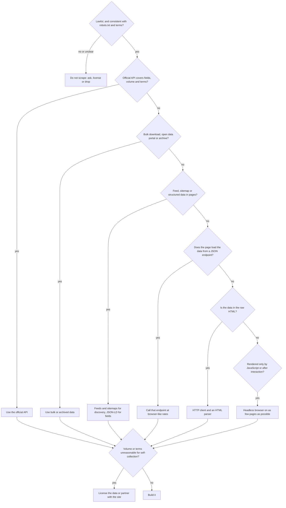

# Choosing an Acquisition Strategy

> Sources: RFC 9309, Robots Exclusion Protocol (https://www.rfc-editor.org/rfc/rfc9309); schema.org (https://schema.org/); Google Search Central, Introduction to structured data (https://developers.google.com/search/docs/appearance/structured-data/intro-structured-data); WordPress REST API Handbook, Discovery (https://developer.wordpress.org/rest-api/using-the-rest-api/discovery/); web.dev, Rendering on the Web (https://web.dev/articles/rendering-on-the-web); Hacker News API (https://github.com/HackerNews/API); Common Crawl (https://commoncrawl.org/)
> Raw: none yet (seed article)
> Updated: 2026-10-24

## Overview

Pick the least intrusive, most stable and cheapest source that meets the requirements, and only move down the ladder when the option above it fails. The ladder: an official API; bulk or open data; feeds, sitemaps and structured data embedded in pages; the site's own JSON endpoints; plain HTML over HTTP; a headless browser; licensed data or a partnership; and finally, not scraping at all. Each step down usually adds fragility, cost and load on the site. The first question is not technical: is collecting this data lawful and consistent with what the site has asked of automated clients? Write the requirements down first (fields, coverage, freshness, history, volume, budget), run a short reconnaissance, then decide, and revisit the decision when the site or the need changes.

## Requirements first

| Requirement | Question | Why it changes the choice |
|---|---|---|
| Fields | Which attributes exactly? | APIs often lack a field the page shows, or the reverse |
| Coverage | All items or a sample? Which regions and languages? | Feeds and APIs may be partial |
| Freshness | Minutes, daily, weekly? | Drives revisit rate, and with it the load and cost |
| History | Do you need the past? | Archives and bulk dumps beat live scraping |
| Volume | Items times revisits per day | Decides whether self-collection is reasonable at all |
| Constraints | Personal data, copyright, terms, budget | Can rule options out entirely |
| Ownership | Who maintains it in six months? | Fragile methods need an owner |

## The decision tree



## The options compared

| Option | Stability | Your cost | Load on the site | How you spot it | Watch out for |
|---|---|---|---|---|---|
| Official API | High | Keys, quotas, sometimes fees | Low | Developer portal, API docs | Terms, quotas, coverage gaps |
| Bulk or open data | High | Storage | None | Data portal, dumps, "download all" | Staleness, size |
| Feeds, sitemaps, structured data | High to medium | Low | Low | `<link rel="alternate">`, `Sitemap:` in robots.txt, JSON-LD | Partial fields |
| Site's own JSON endpoints | Medium | Low | Low to medium | XHR and fetch calls in DevTools | Unannounced changes, tokens, terms |
| Plain HTML | Medium to low | Selector upkeep | Medium | Data visible in view-source | Layout drift |
| Headless browser | Low | CPU, memory, flakiness | Medium to high | Data only after scripts run | Detection, cost, maintenance |
| Licensed data | High | Money | None | Vendors, data marketplaces, the site's sales team | License scope |
| Do not scrape | Not applicable | None | None | Prohibitions, access controls, personal-data risk | Reputational and legal exposure if ignored |

Two notes on the ordering. The site's JSON endpoints come before HTML because the same request the page makes is usually lighter for the server and far more stable to parse than the markup, but they are undocumented: send them only what the page sends, at the rate a visitor's browser would. And a headless browser is the last technical option because it is the most expensive and the most fragile, not because it is forbidden ([When You Need a Browser](../browser-automation/when-to-use-a-browser.md)).

## Stop signs

Choose "do not scrape" (or ask for permission, or license) when:

- robots.txt disallows your paths or your user agent, or the site has opted out of your use case (for example AI training) ([robots.txt (RFC 9309)](../crawling/robots-txt.md), [AI Crawlers and Content Opt-Outs](../llm-scraping/ai-crawlers-and-opt-outs.md)).
- Getting the data means defeating an access control: a login you do not have, a paywall, a CAPTCHA, an IP block.
- The data is personal and you have no lawful basis or no need for it ([Personal Data: GDPR, CCPA and More](../legal-ethics/personal-data-gdpr-ccpa.md)).
- The terms you accepted prohibit automated access, and the risk is not worth it ([Terms of Service and Contracts](../legal-ethics/terms-of-service-and-contracts.md)).
- The volume you need would be a meaningful load on the site.

Asking works more often than people expect: many operators will point you to an export, a feed or a partner API.

## Reconnaissance: cheap signals that decide

One page and one robots.txt request reveal most of the decision:

```python
import json
import re
from urllib.parse import urljoin

import httpx
from selectolax.lexbor import LexborHTMLParser

UA = "acme-recon/1.0 (+https://acme.example/bot; ops@acme.example)"
STATE_MARKERS = {
    "__NEXT_DATA__": "Next.js pages router JSON",
    "self.__next_f": "Next.js App Router RSC payload",
    "__NUXT_DATA__": "Nuxt 3 payload",
    "window.__NUXT__": "Nuxt 2 state",
    "__APOLLO_STATE__": "Apollo GraphQL cache",
    "__PRELOADED_STATE__": "Redux preloaded state",
    "__INITIAL_STATE__": "generic SSR state",
}


def json_ld_types(doc: LexborHTMLParser) -> list[str]:
    types: list[str] = []
    for node in doc.css('script[type="application/ld+json"]'):
        try:
            data = json.loads(node.text())
        except ValueError:
            continue
        for item in data if isinstance(data, list) else data.get("@graph", [data]):
            t = item.get("@type") if isinstance(item, dict) else None
            types += t if isinstance(t, list) else [t] if t else []
    return types


def recon(url: str, expected_text: str | None = None) -> dict:
    """One page, one robots.txt: cheap signals that decide the acquisition strategy."""
    with httpx.Client(headers={"User-Agent": UA}, timeout=15.0, follow_redirects=True) as client:
        page = client.get(url)
        robots = client.get(urljoin(str(page.url), "/robots.txt"))
    html, base = page.text, str(page.url)
    doc = LexborHTMLParser(html)
    feeds = [
        urljoin(base, link.attributes.get("href") or "")
        for link in doc.css("link[rel~=alternate]")
        if re.search(r"(rss|atom)\+xml", link.attributes.get("type") or "")
    ]
    return {
        "status": page.status_code,
        "final_url": base,
        "robots_status": robots.status_code,
        "sitemaps": re.findall(r"(?im)^\s*sitemap:\s*(\S+)", robots.text) if robots.status_code == 200 else [],
        "feeds": feeds,
        "wordpress_api": bool(doc.css_first('link[rel="https://api.w.org/"]')),
        "json_ld": json_ld_types(doc),
        "state_blobs": [label for marker, label in STATE_MARKERS.items() if marker in html],
        "api_paths": sorted(set(re.findall(r"""["'](/(?:api|graphql|wp-json)\b[^"'\s]*)""", html)))[:20],
        "text_in_raw_html": expected_text in html if expected_text else None,
    }


print(json.dumps(recon("https://example.com/product/123", expected_text="89.00"), indent=2))
```

Reading the report: `sitemaps` and `feeds` solve discovery; `json_ld` with a `Product` or `JobPosting` type often solves extraction ([Structured Data (JSON-LD, Microdata, OpenGraph)](../parsing/structured-data-schema-org.md)); `state_blobs` means the page ships its data as JSON ([JSON and Embedded Data](../parsing/json-and-embedded-data.md)); `wordpress_api` means a documented REST API under `/wp-json/`; `text_in_raw_html: false` with no blobs means the data arrives later, so look in the Network panel before considering a browser ([Static vs Dynamic Sites](static-vs-dynamic-sites.md)). Then read robots.txt and the terms yourself; no script decides those.

## Is self-collection reasonable? A load estimate

```text
requests per day = (listing pages + detail pages + extra requests per item) x revisits per day
```

At one request per second to a single host you can make at most 86,400 requests a day, and that is already a heavy, sustained load for a small site. Example: 200,000 products shown 20 per listing page (10,000 listing pages), one detail page each, refreshed daily: 210,000 requests a day, about 2.4 per second around the clock. That is a conversation with the site (a feed, an export, a license), or a design change (conditional requests, sitemap `lastmod`, prioritizing items that change), not a scraper to launch ([Politeness and Rate Limiting](../crawling/politeness-and-rate-limiting.md), [Incremental Crawling](../crawling/incremental-crawling.md)).

## Worked examples

| Need | Recon finding | Choice |
|---|---|---|
| Open jobs at 300 companies | Career pages use a hosted applicant-tracking system with public JSON | Public job-board API ([Job Postings](../sources/job-postings.md)) |
| Monthly statistics | The agency publishes CSV and an API | Bulk download ([Government and Open Data Portals](../sources/government-open-data.md)) |
| Prices at a mid-size shop | Sitemap with `lastmod`, Product JSON-LD in pages | Sitemap discovery plus JSON-LD extraction |
| A listings site with infinite scroll | XHR returns JSON pages of results | Call the JSON endpoint at a browser-like pace |
| Public posts on a social platform | Official research API exists; profiles are personal data | Official program, or do not collect ([Social Media](../sources/social-media.md)) |

## Pitfalls

- **Starting with a headless browser** because it "always works".
- **Not asking the site**, when an export or a feed was one email away.
- **Assuming public means free to use**: licensing and personal-data rules still apply.
- **Choosing by convenience instead of requirements**, then discovering the API lacks a crucial field.
- **Treating an undocumented endpoint as a contract.**
- **Never revisiting the decision.** Sites launch APIs and deprecate them; re-run recon when a scraper breaks.

## Checklist

- [ ] Requirements written: fields, coverage, freshness, history, volume, constraints, owner
- [ ] robots.txt and terms read; stop signs checked
- [ ] Official API, bulk data and feeds searched for
- [ ] Recon report saved with the project
- [ ] Load estimate done and acceptable for the site
- [ ] Choice and its reasons recorded, with a date to revisit

## See Also

- [Scraping vs Crawling vs APIs](scraping-vs-crawling-vs-apis.md)
- [Static vs Dynamic Sites](static-vs-dynamic-sites.md)
- [Catalog of Useful Open APIs](../apis/official-apis-catalog.md)
- [When You Need a Browser](../browser-automation/when-to-use-a-browser.md)
- [Ethical Scraping Checklist](../legal-ethics/ethical-scraping-checklist.md)
- [Runbook: From Request to Scheduled Scraper](../harness/scraping-runbook.md)
