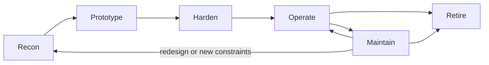

# Scraping Project Lifecycle

> Sources: Google, Site Reliability Engineering, chapter 4 "Service Level Objectives" (https://sre.google/sre-book/service-level-objectives/); Google, Site Reliability Engineering, chapter 6 "Monitoring Distributed Systems" (https://sre.google/sre-book/monitoring-distributed-systems/); Scrapy documentation, Spiders Contracts (https://docs.scrapy.org/en/latest/topics/contracts.html); Regulation (EU) 2016/679 (GDPR), Article 5, on EUR-Lex (https://eur-lex.europa.eu/eli/reg/2016/679/oj); RFC 9309, Robots Exclusion Protocol (https://www.rfc-editor.org/rfc/rfc9309); Ryan Mitchell, Web Scraping with Python, O'Reilly, companion code (https://github.com/REMitchell/python-scraping)
> Raw: none yet (seed article)
> Updated: 2026-10-24

## Overview

A scraper goes through six phases: recon, prototype, harden, operate, maintain and retire. Recon decides whether and how to collect; the prototype proves the fields can be extracted on a representative sample; hardening adds everything that makes it safe to run unattended; operating means scheduled runs with monitoring and owners; maintaining means detecting breakage and repairing it quickly; retiring means stopping cleanly, revoking access and handling the collected data according to its retention rules. Over the life of a scraper, maintenance usually costs more than building it, so the earlier phases should produce what maintenance needs: fixtures, a recorded decision, a schema, raw archives and alerts. Each phase ends with an explicit gate.



## Recon

| | |
|---|---|
| Goal | Decide whether to collect, from where and how |
| Activities | Write requirements; search for APIs, bulk data and feeds; read robots.txt and terms; assess personal data and copyright; inspect pages (raw HTML, embedded JSON, network calls); estimate load |
| Outputs | A recon note with the chosen strategy and why, sample URLs per page template, saved fixtures, open risks |
| Gate | A strategy with a stated reason, and an explicit go or no-go on legal and ethical grounds |

The decision process is in [Choosing an Acquisition Strategy](scraping-decision-framework.md) and the pre-flight questions in [Ethical Scraping Checklist](../legal-ethics/ethical-scraping-checklist.md). Save a few raw responses of every page type now; they become the first test fixtures.

## Prototype

| | |
|---|---|
| Goal | Prove that the required fields can be extracted correctly |
| Activities | Parse saved fixtures first; fetch a small live sample slowly; cover every template and edge case (missing price, sold out, variants, other languages) |
| Outputs | Parser, schema, fixtures, a sample dataset with measured field coverage |
| Gate | Required fields correct on a representative sample (for example 50 pages across templates), known edge cases listed |

Develop against cached or archived responses so that a hundred parser iterations cost the site one fetch ([HTTP Caching and Conditional Requests](../http/caching-and-conditional-requests.md)).

## Harden

| | |
|---|---|
| Goal | Make it safe to run unattended |
| Activities | Timeouts, retries with backoff, per-host rate limits, robots.txt, conditional requests, honest identification; raw archiving; schema validation with quarantine; idempotent storage with provenance; fixture, snapshot and contract tests; secrets in a secret store; structured logs and run metrics |
| Outputs | A deployable job, tests in CI, a runbook, alert rules |
| Gate | Tests pass; a dry run in a staging environment produces expected volumes; the review checklist is signed off |

The component view is in [Anatomy of a Scraper](anatomy-of-a-scraper.md); tests in [Testing Scrapers](../data-quality/testing-scrapers.md); retries in [Retries, Backoff and Idempotency](../operations/retries-backoff-idempotency.md).

## Operate

| | |
|---|---|
| Goal | Deliver data on time with known quality |
| Activities | Scheduling with jitter and overlap protection; monitoring success rates, volumes, freshness and costs; routing alerts to a named owner |
| Outputs | Data meeting agreed objectives, for example "updated by 07:00 UTC, at least 98% of items" |
| Gate (steady state) | Objectives met for several consecutive weeks |

See [Scheduling and Cron](../operations/scheduling-and-cron.md), [Monitoring and Alerting](../operations/monitoring-and-alerting.md) and [Cost Control](../operations/cost-control.md). Service level objectives are worth writing down even for small projects: they turn "is it broken?" into a number.

## Maintain

| | |
|---|---|
| Goal | Detect breakage early and repair it fast |
| Activities | Canary pages, volume and null-rate drift checks, schema failure alerts; triage (site change, block, or our bug); repair with new fixtures from current pages; re-parse archives; backfill gaps |
| Outputs | Versioned parser releases, an incident log, lessons recorded |
| Gate | Each incident closed with a cause, a fix and, where useful, a new test or lesson |

Triage matters most. A layout change needs new selectors; a block (403s, challenges, 429s) needs slowing down and a conversation, not a workaround ([Recognizing Blocks and Responding Responsibly](../anti-bot/blocks-and-responsible-response.md)); a bug of ours needs a test. The repair workflow is in [Maintenance and Breakage Response](../operations/scraper-maintenance-and-breakage.md), and the harness records what it learns in [How the Agents Use and Grow This Vault](../harness/harness-knowledge-workflow.md).

Review periodically, for example every quarter: is the data still used, have robots.txt or the terms changed, has the site launched an API, is the cost still justified?

## Retire

| | |
|---|---|
| Triggers | The need is gone, an official API or license replaces it, terms or robots.txt now forbid it, the site asked you to stop, or the cost outgrew the value |
| Activities | Disable schedules and queues; revoke credentials and API keys; notify consumers; archive or delete data according to retention rules; document why and when |
| Gate | No job can run, no credential works, and the data's fate is recorded |

Personal data has a lifetime: the GDPR's storage limitation principle requires keeping it no longer than necessary for its purpose ([Personal Data: GDPR, CCPA and More](../legal-ethics/personal-data-gdpr-ccpa.md)). If a site owner asks you to stop, stop first and discuss afterwards.

## A project record worth keeping

A short record, kept with the code and updated at each gate, answers most later questions:

```yaml
name: acme-shop-prices
owner: data-team@acme.example
purpose: Daily price index for 30 product categories
decision:
  strategy: sitemap discovery + JSON-LD Product extraction
  rejected: official API lacks unit prices; licensed feed too expensive
  reviewed: 2026-10-24
compliance:
  robots_txt_checked: 2026-10-24
  terms_checked: 2026-10-24
  personal_data: none collected
limits:
  max_rate: 1 request/second, 2 in flight
  revisit: daily, conditional requests
objectives:
  freshness: updated by 07:00 UTC
  completeness: ">= 98% of sitemap products"
alerts: "#data-alerts, on-call data engineer"
retention: raw 90 days, clean data 5 years
next_review: 2027-01-24
```

This is a human-oriented record; the harness has its own machine-readable format ([Declarative Scraper Specs in This Harness](../harness/harness-scraper-spec.md)).

## Pitfalls

- **Skipping recon** and discovering the API, the terms or the personal-data problem after launch.
- **Promoting the prototype straight to production**, without retries, validation or monitoring.
- **No named owner**, so alerts go nowhere.
- **No fixtures saved early**, which makes the first repair a guessing game.
- **No gates**, so "almost done" lasts for months.
- **Never retiring**: zombie scrapers keep loading sites, holding credentials and storing data nobody uses.
- **Never re-checking robots.txt and terms** after the initial review.

## Checklist

- [ ] Recon note with strategy, reasons and a legal and ethical go
- [ ] Fixtures for every page template saved during recon and prototype
- [ ] Field coverage measured on a representative sample
- [ ] Hardening items done: politeness, validation, idempotency, provenance, tests, secrets
- [ ] Objectives, owner and alert routes defined before scheduling
- [ ] Periodic review date set
- [ ] Retirement steps documented: schedules, credentials, data retention

## See Also

- [Choosing an Acquisition Strategy](scraping-decision-framework.md)
- [Anatomy of a Scraper](anatomy-of-a-scraper.md)
- [Maintenance and Breakage Response](../operations/scraper-maintenance-and-breakage.md)
- [Testing Scrapers](../data-quality/testing-scrapers.md)
- [Runbook: From Request to Scheduled Scraper](../harness/scraping-runbook.md)
- [Ethical Scraping Checklist](../legal-ethics/ethical-scraping-checklist.md)
