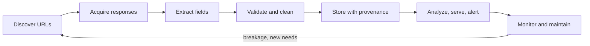

# What Is Web Scraping

> Sources: RFC 9309, Robots Exclusion Protocol (https://www.rfc-editor.org/rfc/rfc9309); The Web Robots Pages (https://www.robotstxt.org/); Wikipedia, Web scraping (https://en.wikipedia.org/wiki/Web_scraping); Wikipedia, World Wide Web Wanderer (https://en.wikipedia.org/wiki/World_Wide_Web_Wanderer); Common Crawl (https://commoncrawl.org/); Internet Archive (https://archive.org/); Beautiful Soup (https://www.crummy.com/software/BeautifulSoup/); Scrapy documentation (https://docs.scrapy.org/en/latest/); Ryan Mitchell, Web Scraping with Python, O'Reilly, companion code (https://github.com/REMitchell/python-scraping)
> Raw: none yet (seed article)
> Updated: 2026-10-24

## Overview

Web scraping is the automated retrieval of web resources and the extraction of specific data from them into structured records. The resources are often HTML pages, but just as often JSON endpoints, feeds, PDFs or images. Scraping sits next to two related activities: crawling, which discovers URLs by following links, and API consumption, which reads data a provider deliberately exposes. Most of the work in a real project is not parsing HTML but everything around it: choosing the least intrusive source, fetching politely, validating what came back, keeping provenance, and repairing the scraper when the site changes. Done responsibly (official APIs first, robots.txt respected, rate limits, honest identification, care with personal data) it powers research, journalism, monitoring and data products.

## A working definition

A scraper does three things a human could do by hand, only repeatably and at scale:

1. **Retrieve** a resource over HTTP (sometimes through a real browser).
2. **Extract** specific fields from it: a price, a title, a table, a list of links.
3. **Emit structured records** with enough context (source URL, fetch time, parser version) to be trusted later.

Older names survive: "screen scraping" originally meant reading the text screens of legacy terminal applications, and "web harvesting" or "web data extraction" mean the same as web scraping. How scraping differs from crawling and from using APIs, and how they combine, is covered in [Scraping vs Crawling vs APIs](scraping-vs-crawling-vs-apis.md).

## A short history

| Year | Milestone |
|---|---|
| 1993 | The World Wide Web Wanderer, written by Matthew Gray at MIT, crawls the web to measure its size |
| 1994 | Martijn Koster proposes the robots exclusion standard (robots.txt) after early robots overload servers |
| 1996 | The Internet Archive is founded; its Wayback Machine later opens the archive to the public |
| 2000 | eBay v. Bidder's Edge, an early US court fight over aggressive automated access |
| 2004 | Beautiful Soup appears for "quick-turnaround screen scraping"; Selenium starts as a browser testing tool |
| 2007 to 2008 | Common Crawl is founded (2007) and starts collecting an open web crawl (2008) |
| 2008 | Scrapy's first public release |
| 2017 | Headless Chrome ships (Chrome 59) and Puppeteer is released |
| 2020 | Playwright is released |
| 2021 | Van Buren v. United States narrows the US computer misuse statute's "exceeds authorized access" |
| 2022 | robots.txt becomes an IETF standard, RFC 9309 |
| 2023 onward | AI crawlers and opt-out tokens (GPTBot and others), LLM-assisted extraction |

The legal milestones are summarized, not analyzed, here; see [Legal Landscape Overview](../legal-ethics/legal-landscape-overview.md) and [CFAA and Key US Cases](../legal-ethics/cfaa-and-key-us-cases.md). The AI-era changes are in [AI Crawlers and Content Opt-Outs](../llm-scraping/ai-crawlers-and-opt-outs.md).

## What people scrape, and how

| Use | Typical sources | Usual approach |
|---|---|---|
| Academic and social research | Public records, forums, archives | Official APIs, dumps, Common Crawl ([Academic and Research Data](../sources/academic-and-research-data.md)) |
| Price and product monitoring | Product pages | Structured data in pages, incremental revisits ([E-commerce and Price Monitoring](../sources/ecommerce-and-prices.md)) |
| Journalism and accountability | Government sites, court records, PDFs | Scheduled scrapers, PDF extraction ([Government and Open Data Portals](../sources/government-open-data.md)) |
| Labor-market data | Job boards, employer career pages | Public applicant-tracking APIs ([Job Postings](../sources/job-postings.md)) |
| Machine learning and retrieval corpora | Large web crawls, encyclopedias | Licensed or open corpora, opt-out handling ([Common Crawl and Web Archives](../crawling/common-crawl-and-archives.md)) |
| Change and compliance monitoring | Terms pages, product listings, competitor announcements | Change detection with alerts ([Change Detection and Diffing](../data-quality/change-detection-and-diffing.md)) |
| Preservation | Any public site | Archival crawls in WARC format |

## The value chain



- **Discover**: sitemaps, feeds, link following, API listings ([Crawler Architecture](../crawling/crawler-architecture.md)).
- **Acquire**: HTTP requests or a browser, with politeness and caching ([HTTP Fundamentals](../http/http-fundamentals.md)).
- **Extract**: selectors, embedded JSON, structured data, sometimes an LLM ([CSS Selectors for Extraction](../parsing/css-selectors.md)).
- **Validate and clean**: schemas, normalization, deduplication ([Schema Validation](../data-quality/schema-validation.md)).
- **Store**: raw responses for re-parsing plus clean tables ([Data Modeling for Scraped Data](../storage/data-modeling-for-scraped-data.md)).
- **Monitor and maintain**: success rates, volumes, breakage repair ([Maintenance and Breakage Response](../operations/scraper-maintenance-and-breakage.md)).

## A minimal, polite scraper

The sandbox `quotes.toscrape.com` exists for practice. This script reads robots.txt, identifies itself, follows pagination, waits between requests and records where each record came from:

```python
import json
import time
from datetime import datetime, timezone
from urllib.parse import urljoin
from urllib.robotparser import RobotFileParser

import httpx
from selectolax.lexbor import LexborHTMLParser

START = "https://quotes.toscrape.com/page/1/"  # a sandbox built for scraping practice
UA = "quotes-tutorial-bot/0.1 (+https://example.org/contact)"

with httpx.Client(headers={"User-Agent": UA}, timeout=15.0, follow_redirects=True) as client:
    robots = RobotFileParser()
    rr = client.get(urljoin(START, "/robots.txt"))
    if rr.status_code >= 500:
        raise SystemExit("robots.txt unreachable: RFC 9309 says to assume full disallow, retry later")
    robots.parse(rr.text.splitlines() if rr.status_code == 200 else [])  # 4xx: no rules apply

    url, pages = START, 0
    with open("quotes.jsonl", "w", encoding="utf-8") as out:
        while url and robots.can_fetch(UA, url) and pages < 50:
            r = client.get(url)
            r.raise_for_status()
            doc = LexborHTMLParser(r.text)
            for q in doc.css("div.quote"):
                out.write(json.dumps({
                    "text": q.css_first("span.text").text(strip=True),
                    "author": q.css_first("small.author").text(strip=True),
                    "tags": [a.text(strip=True) for a in q.css("div.tags a.tag")],
                    "source_url": str(r.url),
                    "fetched_at": datetime.now(timezone.utc).isoformat(),
                }, ensure_ascii=False) + "\n")
            nxt = doc.css_first("li.next a")
            url = urljoin(str(r.url), nxt.attributes["href"]) if nxt else None
            pages += 1
            time.sleep(1.0)  # about one request per second is plenty for a small site
print(pages, "pages")
```

Fetching robots.txt with your own client (rather than `RobotFileParser.read()`, which has no timeout) keeps the same User-Agent and timeout for every request. The production version of this loop adds validation, retries, storage and monitoring ([Anatomy of a Scraper](anatomy-of-a-scraper.md)).

## Responsible scraping in brief

- **Look for the sanctioned route first**: official APIs, bulk downloads, feeds, licensed datasets ([Choosing an Acquisition Strategy](scraping-decision-framework.md)).
- **Read robots.txt and the terms.** RFC 9309 states that robots.txt rules "are not a form of access authorization", yet they are the operator's stated wishes, and ignoring them weighs against you.
- **Be light and identifiable**: modest rates, conditional requests, a User-Agent with contact details ([Identifying Your Bot](../anti-bot/identifying-your-bot.md)).
- **Respect access controls**: no borrowed logins, no CAPTCHA solving, no paywall bypassing.
- **Personal data stays personal** even when public ([Personal Data: GDPR, CCPA and More](../legal-ethics/personal-data-gdpr-ccpa.md)).

This vault is not legal advice; [Ethical Scraping Checklist](../legal-ethics/ethical-scraping-checklist.md) turns these principles into a pre-flight list.

## Pitfalls

- **Equating scraping with parsing.** Fetching, validation and maintenance take most of the effort.
- **Skipping the search for an API or dataset** and building a fragile scraper for data that was available cleanly.
- **Reaching for a browser first** when the data is in the HTML or in a JSON endpoint.
- **No provenance.** Records without source URL and fetch time cannot be audited or re-parsed.
- **Treating a one-off script as a pipeline**: no validation, no monitoring, silent failure.
- **Ignoring the legal and ethical side** until someone complains.

## Checklist

- [ ] The question the data must answer is written down
- [ ] Official APIs, dumps and licensed sources checked first
- [ ] robots.txt and terms read; personal data assessed
- [ ] Honest User-Agent, rate limit and timeouts configured
- [ ] Every record carries source URL, fetch time and parser version
- [ ] Someone owns maintenance once it runs on a schedule

## See Also

- [Scraping vs Crawling vs APIs](scraping-vs-crawling-vs-apis.md)
- [Choosing an Acquisition Strategy](scraping-decision-framework.md)
- [Anatomy of a Scraper](anatomy-of-a-scraper.md)
- [Learning Path: Zero to Production](learning-path.md)
- [Ethical Scraping Checklist](../legal-ethics/ethical-scraping-checklist.md)
- [Legal Landscape Overview](../legal-ethics/legal-landscape-overview.md)
